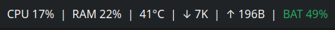
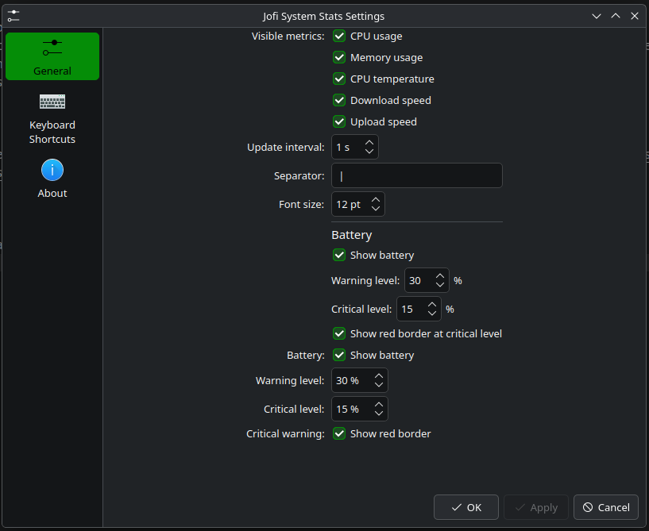

# Jofi System Stats

A lightweight, text-only system monitor for the KDE Plasma 6 panel. It keeps useful system information visible without taking the space of a full monitoring widget.


## Screenshots

Panel view:



Configuration dialog:



## Features

- CPU usage
- Physical memory usage
- Average CPU temperature
- Network download and upload speed
- Battery percentage and charging state
- Battery warning and critical colors
- Optional red panel border when the battery reaches the critical level
- Configurable update interval, separator, font size, and visible metrics
- Compact panel representation with a detailed expanded representation

The widget uses KDE SystemStats sensors, so the metrics shown depend on the sensors available on the host system. Battery information is discovered automatically when a supported battery sensor is available.

## Requirements

- KDE Plasma 6
- `kdeplasma-addons` / KDE SystemStats components provided by the Plasma installation

This applet is intended for Linux systems running Plasma 6. It is not compatible with Plasma 5.

## Installation

### From the Plasma desktop

1. Download or clone this repository.
2. Right-click the Plasma panel and choose **Enter Edit Mode**.
3. Choose **Add Widgets**, then **Get New Widgets** or **Install from File**.
4. Select the packaged applet file if you have one, then add **Jofi System Stats** to the panel.

### From a local checkout

From the repository directory, run:

```sh
kpackagetool6 --type Plasma/Applet --install .
```

If an earlier version is already installed, use:

```sh
kpackagetool6 --type Plasma/Applet --upgrade .
```

Then add **Jofi System Stats** from the widget chooser. To remove the installed applet:

```sh
kpackagetool6 --type Plasma/Applet --remove hu.jofi.systemstats
```

## Configuration

Open the widget settings to configure:

- Which CPU, memory, temperature, download, and upload values are shown
- The refresh interval, from 250 ms to 10 seconds
- The separator displayed between metrics
- Panel font size
- Battery visibility
- Battery warning and critical thresholds
- Whether a red border is shown at the critical battery level

Changes are stored in the normal Plasma widget configuration and take effect immediately.

## Development

The applet is intentionally small and does not require a build system. The main files are:

```text
metadata.json              Package metadata
contents/ui/main.qml       Panel and expanded representations
contents/ui/configGeneral.qml  Widget settings page
contents/config/main.xml   Persistent configuration defaults
contents/config/config.qml Configuration category registration
```

After editing the files, reinstall or upgrade the local package and restart the widget if Plasma has cached the previous package contents.

### Building a release package

The repository includes `scripts/build-release.sh`, which creates a versioned `.plasmoid` package in `dist/`:

```sh
./scripts/build-release.sh
```

The script reads the version from `metadata.json` and requires `jq` and `zip`. The resulting file can be installed from the Plasma widget settings or with:

```sh
kpackagetool6 --type Plasma/Applet --install dist/jofi-system-stats-1.1.0.plasmoid
```

GitHub Actions automatically builds and publishes a downloadable GitHub release when a version tag is pushed:

```sh
git tag v1.1.1
git push origin v1.1.1
```

Keep the tag version and `KPlugin.Version` in `metadata.json` in sync.

## Known limitations

- Sensor names and availability are provided by the host's KDE SystemStats installation.
- CPU temperature and battery values may be unavailable on systems without matching sensors; the widget does not emulate or estimate missing readings.
- The current interface is designed for a compact horizontal Plasma panel.

## Contributing

Bug reports, feature requests, and pull requests are welcome at [github.com/gyjofi/jofi-system-stats](https://github.com/gyjofi/jofi-system-stats).

## License

Jofi System Stats is released under the [MIT License](LICENSE).
